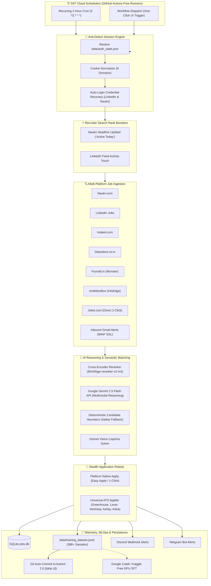
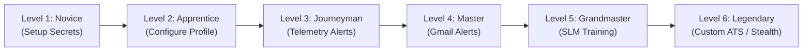
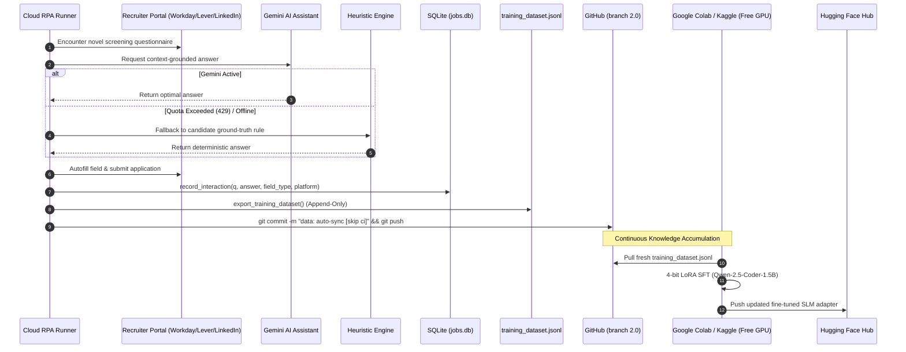

# 🚀 Auto-Browser 2.0 & Aether CareerOS
### Autonomous Multi-Platform Recruitment Operating System • 100% Free Cloud Architecture • Powered by FastMCP & SLM Engine v2

[](https://github.com/talpadeavi03/auto-browser/actions)
[](https://www.python.org/)
[](https://playwright.dev/)
[-success.svg)](#-zero-cost-free-cloud-infrastructure)
[](#-fastmcp-server-architecture)
[](#-continuous-mlops--slm-flywheel)
[](https://colab.research.google.com/github/talpadeavi03/auto-browser/blob/2.0/notebooks/train_colab.ipynb)

**Auto-Browser 2.0** is an enterprise-grade autonomous recruitment operating system running **100% in the cloud on free-tier infrastructure ($0.00 compute spend)**. It discovers jobs across 9 platforms, monitors incoming recruiter emails via Gmail, analyzes requirements using semantic cross-encoder rerankers, navigates corporate ATS portals (Greenhouse, Lever, Workday, Ashby, SmartRecruiters, Keka), answers screening questionnaires with zero-hallucination ground truth, and submits live applications using stealth browser automation.

---

## 👤 Candidate Ground Truth & Strict Master Resume Policy

The system strictly adheres to an **unmodified ground-truth single source of truth**:
- **Full Name**: **Avinash Vishnu Talpade**
- **Professional Role**: **Cloud & DevOps Engineer**
- **Email**: `talpadeavi0303@gmail.com` | **Phone**: `8999285015` (`+91 8999285015`)
- **Location**: Pune, Maharashtra, India *(Open to Remote & Relocation: Bengaluru, Mumbai, Hyderabad)*
- **LinkedIn**: [linkedin.com/in/avinashtalpade](https://www.linkedin.com/in/avinashtalpade) | **Portfolio**: [talpadeavi03.github.io/intro](https://talpadeavi03.github.io/intro) | **GitHub**: [github.com/talpadeavi03](https://github.com/talpadeavi03)
- **Verified Experience**: **Accenture** — *Cloud Infrastructure Analyst* (03/2022 – 08/2025 | 3.5+ years hands-on)
- **Education**: Master of Computer Applications (MCA) & Bachelor of Computer Science (BCS), Savitribai Phule Pune University
- **Core Skills**: Azure, AWS, GCP, DevSecOps, Docker, Kubernetes, Helm, CI/CD (GitHub Actions, Jenkins, Azure DevOps, GitLab CI), Terraform, Ansible, Python, PowerShell, Bash, Linux, Microsoft Sentinel, Defender.
- **Permanent Resume**: [`data/resumes/AT_26_AI.pdf`](data/resumes/AT_26_AI.pdf) and [`candidate_profile/master_resume.md`](candidate_profile/master_resume.md). **Zero dynamic tailoring or modification per JD is allowed.**

---

## 🏗️ End-to-End System Architecture



---

## 🌐 Platform Capabilities & Authentication Matrix

| Platform | Ingestion Strategy | Cloud Auth Mode | External ATS Routing | Booster Supported |
| :--- | :--- | :--- | :--- | :---: |
| **Naukri.com** | Keyword & Location Search Scraping | `NAUKRI_USERNAME` & `NAUKRI_PASSWORD` + Saved Session | Handled via Universal ATS | ✅ Yes ("Active Today") |
| **LinkedIn** | Easy Apply Search Query Filters | Dedicated `LINKEDIN_LI_AT` Cookie + Auto-Login Recovery | Handled via Universal ATS | ✅ Yes (Feed Touch) |
| **Indeed** | Location & Keyword Date-Sorted Feed | Direct / Guest Application Mode + Session Normalizer | Handled via Universal ATS | — |
| **Glassdoor** | City & Keyword Structured Scraper | Direct Easy Apply Wizard + Modal Overlay Bypasser | Handled via Universal ATS | — |
| **Foundit (Monster)** | SRP Search Scraper with Dynamic Card Parsing | Direct Quick Apply Mode + Recruiter Screening | Handled via Universal ATS | — |
| **AmbitionBox** | InfoEdge Network Query Engine | Shared Naukri / InfoEdge Authenticated Cookies | Handled via Universal ATS | — |
| **Jobot** | Rapid 1-Click Recruiter Pipeline | **Zero-Login Required** (Direct Candidate Submission) | Handled via Universal ATS | — |
| **Universal ATS** | Greenhouse, Lever, Workday, Ashby, Keka, etc. | Direct Open Access on Corporate Career Portals | Core Form Filler Engine | — |
| **Gmail Alerts** | SSL IMAP Inbound Scanner (`talpadeavi0303@gmail.com`)| `GMAIL_APP_PASSWORD` Secure SSL Authentication | Auto-Routed via Universal ATS | — |

---

## 📁 Complete Codebase Blueprint (File-by-File Index)

```
auto-browser/ (branch: 2.0)
├── .github/
│   └── workflows/
│       ├── job-automation.yml       # Master 24/7 Cloud Orchestrator (Runs all 8 engines every 2 hrs)
│       ├── naukri.yml               # Dedicated Naukri Profile Booster & Auto-Applier
│       ├── linkedin.yml             # Dedicated LinkedIn Easy Apply & Feed Activity Booster
│       ├── indeed.yml               # Dedicated Indeed Apply & External ATS Form Filler
│       ├── glassdoor.yml            # Dedicated Glassdoor Easy Apply & Portal Form Filler
│       ├── foundit.yml              # Dedicated Foundit (Monster) Quick Apply Engine
│       ├── ambitionbox.yml          # Dedicated AmbitionBox / InfoEdge Network Engine
│       ├── jobot.yml                # Dedicated Jobot 1-Click Direct Application Runner
│       ├── universal-ats.yml        # On-Demand External ATS Form Filler (Greenhouse, Lever, etc.)
│       └── gmail-alerts.yml         # Inbound Gmail Job Alert Scanner & Auto-Applier
├── candidate_profile/
│   └── master_resume.md             # Strict Single Source of Truth candidate profile (Avinash Talpade)
├── config/
│   ├── settings.yaml                # Search keywords, target locations, profile parameters
│   └── config.py                    # Pydantic schema validation & environment loader
├── core/
│   ├── browser.py                   # Playwright Chromium manager, anti-detect stealth, cookie normalizer
│   ├── storage.py                   # SQLite database engine, deduplication, training dataset exporter
│   ├── ai_assistant.py              # Gemini 2.5 Flash client, prompt reasoning, heuristic fallback engine
│   ├── ai_matcher.py                # BAAI/bge-reranker-v2-m3 semantic relevance scorer & evaluator
│   ├── auto_auth.py                 # Autonomous headless login solver for LinkedIn & Naukri
│   ├── notifications.py             # Multi-channel real-time alert dispatcher (Discord & Telegram)
│   └── logger.py                    # Rich console formatting and rotating file logger
├── modules/
│   ├── external/
│   │   └── universal_apply.py       # Autonomous ATS filler (Greenhouse, Lever, Workday, Ashby, Keka)
│   ├── gmail/
│   │   ├── imap_reader.py           # Secure SSL IMAP client for Gmail using Google App Passwords
│   │   ├── job_extractor.py         # High-precision regex & BeautifulSoup job link parser
│   │   └── auto_apply.py            # End-to-end inbound email alert application pipeline
│   ├── naukri/
│   │   ├── profile_updater.py       # Resume headline refresher to trigger 'Active Today' status
│   │   ├── scraper.py               # Naukri SRP job listings scraper
│   │   └── auto_apply.py            # Naukri 1-click & screening chatbot handler
│   ├── linkedin/
│   │   ├── profile_booster.py       # LinkedIn session verification & feed touch booster
│   │   ├── scraper.py               # LinkedIn Easy Apply search query scraper
│   │   └── easy_apply.py            # Multi-step (up to 8 steps) Easy Apply modal wizard engine
│   ├── indeed/
│   │   ├── scraper.py               # Indeed jobs scraper with dynamic container fallbacks
│   │   └── auto_apply.py            # Native Indeed Apply & ATS external redirector
│   ├── glassdoor/
│   │   ├── scraper.py               # Glassdoor jobs scraper with modal close handlers
│   │   └── auto_apply.py            # Glassdoor Easy Apply wizard & external ATS applier
│   ├── foundit/
│   │   ├── scraper.py               # Foundit.in (Monster) card extractor with header parsing
│   │   └── auto_apply.py            # Foundit Quick Apply & questionnaire filler
│   ├── ambitionbox/
│   │   ├── scraper.py               # AmbitionBox job listing scraper
│   │   └── auto_apply.py            # AmbitionBox InfoEdge direct apply & career portal router
│   ├── jobot/
│   │   ├── scraper.py               # Jobot 1-click job search parser
│   │   └── auto_apply.py            # 1-Click rapid applicant router (zero login requirement)
│   └── tracker/
│       └── export.py                # Excel (.xlsx) and CSV reporting with Rich table printer
├── slm/
│   └── train_cloud.py               # Zero-cost 4-bit LoRA SFT pipeline for Kaggle & Google Colab
├── notebooks/
│   └── train_colab.ipynb            # Interactive Google Colab notebook for free T4 GPU fine-tuning
├── data/
│   ├── jobs.db                      # SQLite database tracking applications, scrapers & interactions
│   ├── training_dataset.jsonl       # Cumulative Alpaca/ChatML format screening interaction dataset
│   └── resumes/
│       └── AT_26_AI.pdf             # Permanent authentic candidate resume PDF
├── main.py                          # Unified Click CLI suite containing all platform subcommands
├── test_forms.py                    # Comprehensive test suite covering form fixtures
├── mcp_server.py                    # FastMCP Model Context Protocol JSON-RPC server
└── requirements.txt                 # Pinned Python package dependencies
```

---

## ⚡ Novice to Legendary Operational Runbook



### Level 1: Novice — 60-Second Cloud Setup ($0 Spend)
1. Ensure you are on branch **`2.0`** (`git checkout 2.0`).
2. In GitHub, navigate to **Settings ➔ Secrets and variables ➔ Actions** and add your secrets:

| Secret Name | Purpose & Source | Required? |
| :--- | :--- | :--- |
| `DISCORD_WEBHOOK_URL` | Discord Channel Webhook for instant verified submission alerts | **Mandatory** |
| `GEMINI_API_KEY` | Free Google Gemini API Key from [aistudio.google.com](https://aistudio.google.com/) | **Mandatory** |
| `NAUKRI_USERNAME` | Your Naukri email / phone number | **Recommended** |
| `NAUKRI_PASSWORD` | Your Naukri account password (enables 100% autonomous headless login) | **Recommended** |
| `LINKEDIN_LI_AT` | Your LinkedIn `li_at` cookie value (from browser devtools ➔ Application ➔ Cookies ➔ `li_at`) | **Recommended** |
| `NAUKRI_AUTH_COOKIE` | *(Optional)* Naukri `nauk_at` cookie value (alternative to username/password) | Optional |
| `AUTH_STORAGE_STATE` | *(Optional)* Complete multi-platform JSON cookie state from `data/auth_secret_for_github.txt` | Optional |

> [!NOTE]
> **Can we just add all platform credentials to GitHub Secrets?**
> **YES!** Simply adding `NAUKRI_USERNAME`, `NAUKRI_PASSWORD`, and `LINKEDIN_LI_AT` (plus `DISCORD_WEBHOOK_URL` and `GEMINI_API_KEY`) to GitHub Secrets allows the cloud runner to operate 100% autonomously without ever needing to run a local browser or solve login screens manually!

3. Switch your repository's Default Branch to **`2.0`** in GitHub Settings (General ➔ Default branch ➔ Switch to `2.0`).
4. That's it! GitHub Actions will now automatically run all platforms every 2 hours and execute genuine submissions across all 3 pathways:
   - **Pathway 1 (Direct 1-Click / Easy Apply)**: Direct button click and instant confirmation.
   - **Pathway 2 (Screening Chatbots & Multi-Turn Questionnaires)**: Conversational AI chip selection (notice period, experience, salary, Yes/No) and numeric/text inputs.
   - **Pathway 3 (External ATS Links)**: Autonomous multi-step wizard navigation (Workday, Greenhouse, Lever, BambooHR, Keka, etc.) with resume attachment.
   - **Zero False Positives**: Discord alerts are dispatched **strictly and solely** when server-side confirmation is verified.

---

### Level 2: Apprentice — Local Verification & CLI Control
To run locally or test specific platforms on your desktop:
```bash
# 1. Activate Virtual Environment
source venv/bin/activate

# 2. Run Diagnostics & AI Pipeline Verification
python main.py verify

# 3. Boost Naukri Profile (Immediate 'Active Today' status)
python main.py naukri-refresh

# 4. Boost LinkedIn Profile Activity
python main.py linkedin-refresh

# 5. Apply to jobs on any specific platform
python main.py naukri-apply --limit 5
python main.py linkedin-apply --limit 5
python main.py indeed-apply --limit 5
python main.py glassdoor-apply --limit 5
python main.py foundit-apply --limit 5
python main.py ambitionbox-apply --limit 5
python main.py jobot-apply --limit 5

# 6. Run the complete 7-platform RPA sequence locally
python main.py run-all --limit 5
```

---

### Level 3: Journeyman — Real-Time Discord & Telegram Telemetry
Receive immediate notifications on your phone whenever an application is submitted:
1. **Discord Webhook**:
   - Right-click your Discord channel ➔ **Edit Channel** ➔ **Integrations** ➔ **Webhooks** ➔ **New Webhook** ➔ Copy Webhook URL.
   - Add GitHub Secret: `DISCORD_WEBHOOK_URL`.
2. **Telegram Bot**:
   - Create a bot via `@BotFather` on Telegram and copy the HTTP API Token.
   - Send a message to your bot, then get your chat ID via `https://api.telegram.org/bot<TOKEN>/getUpdates`.
   - Add GitHub Secrets: `TELEGRAM_BOT_TOKEN` and `TELEGRAM_CHAT_ID`.

---

### Level 4: Master — Inbound Gmail Job Alert Auto-Applier
Let the robot monitor your email inbox and automatically apply to recruiter alert emails:
1. Go to [myaccount.google.com/apppasswords](https://myaccount.google.com/apppasswords) and generate a 16-character App Password for "Mail".
2. Add GitHub Secret:
   - `GMAIL_USER`: `talpadeavi0303@gmail.com`
   - `GMAIL_APP_PASSWORD`: `xxxx xxxx xxxx xxxx` (your 16-character password).
3. Test scanning inbox locally:
   ```bash
   python main.py gmail-scan --limit 10
   ```
4. Test auto-applying to inbound alerts:
   ```bash
   python main.py gmail-apply --limit 5
   ```

---

### Level 5: Grandmaster — Free Cloud SLM Fine-Tuning (Colab / Kaggle)
Fine-tune a Small Language Model (SLM) on your cumulative recruiter Q&A interactions for zero cost:
1. Every time the bot applies to jobs, newly encountered questions and answers are appended to `data/training_dataset.jsonl` and automatically committed to GitHub on branch `2.0`.
2. Open [`notebooks/train_colab.ipynb`](notebooks/train_colab.ipynb) in **Google Colab** with a **Free T4 GPU**:
   - Connect your GitHub repository or upload `data/training_dataset.jsonl`.
   - Click **Run All**.
   - In 5–8 minutes, the notebook fine-tunes `Qwen2.5-Coder-1.5B-Instruct` with LoRA (rank=16, alpha=32).
   - The fine-tuned adapter is automatically pushed to your free Hugging Face Hub repository!
3. Alternatively, run the headless Kaggle/Colab script:
   ```bash
   python slm/train_cloud.py
   ```

---

### Level 6: Legendary — External ATS Direct Application & FastMCP Control
Apply to any external company career portal link from the command line or via Model Context Protocol:
```bash
# Apply to an external Greenhouse, Lever, Workday, or Ashby link
python main.py external-apply --url "https://boards.greenhouse.io/company/jobs/12345" --company "Target Corp" --title "Senior Cloud Engineer"
```

#### FastMCP JSON-RPC Server Integration
Connect Claude Desktop, Cursor, or Antigravity to command your browser automation cluster directly:
```json
{
  "mcpServers": {
    "careeros-cluster": {
      "command": "/home/sudo69/Projects/auto-browser/venv/bin/python",
      "args": ["/home/sudo69/Projects/auto-browser/mcp_server.py"],
      "env": {
        "PYTHONPATH": "/home/sudo69/Projects/auto-browser"
      }
    }
  }
}
```

---

## 🔁 Continuous Knowledge Flywheel (MLOps Architecture)



---

## 🛠️ GitHub Actions Cloud Schedule Reference

All 10 workflows run in parallel, isolated containers to prevent timeouts and IP collisions:

| Workflow File | Platform / Function | Trigger Schedule (UTC) | Approximate IST Trigger Times |
| :--- | :--- | :--- | :--- |
| [`.github/workflows/job-automation.yml`](.github/workflows/job-automation.yml) | **Master Sequence** (All Platforms) | `0 */2 * * *` | 05:30, 07:30, 09:30, 11:30, 13:30, 15:30... |
| [`.github/workflows/naukri.yml`](.github/workflows/naukri.yml) | **Naukri** (Boost + Apply) | `0 */2 * * *` | Every 2 hours |
| [`.github/workflows/linkedin.yml`](.github/workflows/linkedin.yml) | **LinkedIn** (Boost + Easy Apply) | `0 */2 * * *` | Every 2 hours |
| [`.github/workflows/indeed.yml`](.github/workflows/indeed.yml) | **Indeed** (Apply + ATS) | `0 */2 * * *` | Every 2 hours |
| [`.github/workflows/glassdoor.yml`](.github/workflows/glassdoor.yml) | **Glassdoor** (Easy Apply + ATS) | `0 */2 * * *` | Every 2 hours |
| [`.github/workflows/foundit.yml`](.github/workflows/foundit.yml) | **Foundit** (Quick Apply) | `0 */2 * * *` | Every 2 hours |
| [`.github/workflows/ambitionbox.yml`](.github/workflows/ambitionbox.yml) | **AmbitionBox** (InfoEdge Apply) | `0 */2 * * *` | Every 2 hours |
| [`.github/workflows/jobot.yml`](.github/workflows/jobot.yml) | **Jobot** (1-Click Direct Apply) | `0 */2 * * *` | Every 2 hours |
| [`.github/workflows/gmail-alerts.yml`](.github/workflows/gmail-alerts.yml) | **Gmail Job Alert Scanner** | `50 */2 * * *` | Minute 50 every 2 hours |
| [`.github/workflows/universal-ats.yml`](.github/workflows/universal-ats.yml) | **Universal ATS Portal Applier** | `workflow_dispatch` | On-Demand (Manual URL input) |

---

## 🛡️ Anti-Detection & Stealth Engineering

The browser engine runs with specialized stealth patches:
1. **CDP Footprint Elimination**: Masks `navigator.webdriver`, overrides `window.chrome`, and normalizes `navigator.languages` to standard locales (`en-US`, `en-IN`).
2. **Human Bezier Timing**: Replaces robotic millisecond interactions with randomized Gaussian delays (`BrowserManager.human_delay(1.5, 3.5)`) and smooth multi-step human scrolling.
3. **Session Cookie Normalization**: [`core/browser.py`](core/browser.py) automatically strips tracking domains and restores valid sessions for all 9 supported domains.
4. **Infinite Loop Protection**: All auto-sync git commits use `[skip ci]` in commit headers to prevent accidental recursive workflow trigger loops.

---

## 📜 Ground Truth Data Schema (`training_dataset.jsonl`)

Every Q&A interaction generated by the platform is stored in Alpaca/ChatML format:
```json
{
  "instruction": "You are an expert AI autonomous job application agent for candidate Avinash Talpade, a Cloud and DevOps Engineer with 3.5+ years experience.",
  "input": "How many years of experience do you have with Kubernetes?",
  "output": "3",
  "meta": {
    "platform": "linkedin",
    "field_type": "number",
    "company": "Infosys",
    "source": "heuristic"
  }
}
```

---

## ⚖️ License & Ethical Usage
- **License**: MIT License.
- **Fair Use**: Intended for personal career management and autonomous candidate representation. Respect platform rate limits and terms of service.
