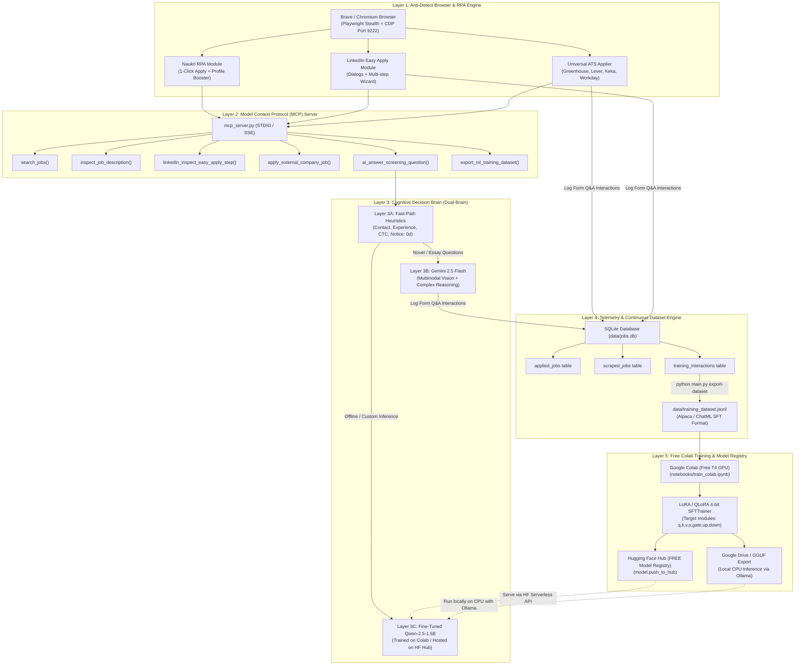

# 🏗️ Auto-Browser: Project Architecture & System Design Specification

> **Version:** 2.0.0 (Production / Hybrid MLOps Edition)  
> **Author:** Avinash Talpade & Antigravity Advanced Agentic Engineering  
> **Repository:** `https://github.com/talpadeavi03/auto-browser.git`  
> **Target Positions:** DevOps, MLOps, System, DevSecOps, Infrastructure, Cloud Engineer

---

## 1. Executive Summary & Core Mission

**Auto-Browser** is an enterprise-grade, autonomous Robotic Process Automation (RPA) and AI Agentic suite designed to eliminate the manual toil of technical job searching, application submission, and profile visibility management. 

Operating seamlessly across **Naukri.com**, **LinkedIn**, and **External Applicant Tracking Systems (ATS)** (such as *Keka, Greenhouse, Lever, Workday, SmartRecruiters*), Auto-Browser combines:
1. **Undetectable Anti-Bot Stealth Execution** (via Chromium CDP & Playwright Stealth).
2. **Standardized Model Context Protocol (MCP)** interface for AI agent integration.
3. **Dual-Brain Cognitive Engine** (Deterministic Fast-Path + Multimodal Google Gemini 2.5 Flash).
4. **Autonomous Captcha Resolution** (Canvas extraction + Gemini Vision OCR).
5. **Continuous Telemetry & Free MLOps Distillation Pipeline** (Google Colab T4 GPU + LoRA + Hugging Face Hub).
6. **24/7 Serverless Cloud CI/CD Execution** (GitHub Actions with headless virtual displays).

---

## 2. System Architecture & 5-Layer Stack



---

## 3. End-to-End Application Flows

### 3.1 Naukri.com Automation Flow
1. **Resume Headline Profile Booster (`naukri-refresh`)**:
   - Navigates to `https://www.naukri.com/mnjuser/profile`.
   - Locates the candidate's Resume Headline.
   - Appends or toggles an alternating character (trailing dot) and saves.
   - **Result:** Naukri updates the profile's `last_updated_at` timestamp, placing the candidate at the top of recruiter searches as **"Active Today"**.
2. **1-Click Auto-Apply (`naukri-apply`)**:
   - Queries target roles (`DevOps`, `MLOps`, `System`, `DevSecOps`, `Infrastructure`, `Cloud`).
   - If a listing features direct apply, it triggers the application modal, answers screening questions via heuristic context or Gemini AI, and submits.
   - If redirected to an external employer portal ("Apply on company site"), it hands off the target URL to the **Universal ATS Applier**.

### 3.2 LinkedIn Easy Apply Automation Flow
1. **Language & Interface Enforcement**:
   - Verifies the page language is strictly `en-US`. If Bengali or another language is detected from historical cookies, it automatically sends an authenticated API update to `/mysettings-api/settingsApiSettings/interfaceLocale` and injects `lang="v=2&lang=en-us"; Secure; SameSite=None`.
2. **HTML5 `<dialog>` Wizard Navigation**:
   - Detects modern LinkedIn `<dialog>` and modal elements.
   - Steps through: Contact Info $\rightarrow$ Home Address $\rightarrow$ Screening Questions $\rightarrow$ Resume Selection $\rightarrow$ Review $\rightarrow$ Submit.
3. **Screening Questionnaire Resolution**:
   - **Notice Period Validation:** Converted strictly to digits (`0` for Immediate Joiner) when form constraints require numeric days.
   - **Work Authorization & Sponsorship:** Automatically mapped to `Yes` (Authorized) and `No` (Sponsorship).
   - **Dropdown Integrity:** Keeps verified pre-selected phone country codes (`+91 India`) to prevent form reset errors.

### 3.3 Universal ATS Autonomous Form Engine
Handles external corporate career pages (*Keka, Greenhouse, Lever, Workday, SmartRecruiters*):
1. **Landing CTA Detection**: Clicks "Apply Now" or "Apply for this job" buttons.
2. **Safe Field Resolution (`_safe_fill`)**:
   - Inspects `inp.is_editable()` and `inp.get_attribute("readonly")`.
   - Bypasses readonly datepicker traps that otherwise cause 30-second Playwright timeouts.
   - Separates Notice Period / Availability from start/joining dates.
3. **Candidate Data Population**:
   - Injects full name, email, phone, location, LinkedIn, GitHub.
   - Injects educational credentials (B.E., Information Technology, Savitribai Phule Pune University).
   - Injects work history (DevOps Engineer, Cloud Solutions Inc., 3.6 years).
   - Injects compensation (Current: 4.5 LPA, Expected: 8.5 LPA).
4. **Checkbox & Radio Resolution**:
   - Auto-checks "Currently working here" (`isCurrentlyWorking`).
   - Auto-checks positive options (`Option 0` / "Yes") for technical screening questions (Database migration, AWS migration, Network migration, Pune location).
   - Auto-checks legal consent and privacy policy checkboxes.
5. **Autonomous Captcha Resolution**:
   - Locates image/canvas captchas (e.g. ``).
   - Extracts raw PNG base64 via DOM Canvas API.
   - Submits to Gemini 2.5 Flash Vision OCR to extract alphanumeric tokens (`MU67B`).
   - Types result into `#captcha` and submits.

---

## 4. DevOps & Cloud CI/CD Architecture

### 4.1 GitHub Actions Workflow Pipeline
The suite runs completely headlessly on GitHub-hosted Ubuntu runners (`ubuntu-latest`) via [`.github/workflows/job-automation.yml`](file:///.github/workflows/job-automation.yml):

```yaml
name: 24/7 Cloud Job Automation & Profile Booster

on:
  push:
    branches: [ master, main ]
  schedule:
    - cron: '0 */4 * * *'  # Runs every 4 hours automatically
  workflow_dispatch:
    inputs:
      action:
        type: choice
        options: [ 'run-all', 'naukri-boost', 'linkedin-apply', 'naukri-apply', 'scrape-jobs' ]
```

### 4.2 Cloud Execution Lifecycle
1. **Checkout & Python 3.12 Setup**: Installs requirements and bundled Playwright Chromium binaries with OS dependencies.
2. **Session Injection**:
   - Decodes `secrets.AUTH_STORAGE_STATE`.
   - Runs automatic base64 padding calculation (`missing_padding = len(clean_b64) % 4`).
   - Writes `data/auth_state.json` with 43 active cookies.
3. **Headless Execution with Virtual Framebuffer (`xvfb-run -a`)**:
   - Executes `naukri-refresh`, `linkedin-apply --limit 5`, and `naukri-apply --limit 5` in an emulated X11 screen (resolution: 1400x900).
4. **Continuous Telemetry Export**:
   - Generates Excel report (`job_report_TIMESTAMP.xlsx`) and CSV report (`applied_jobs_TIMESTAMP.csv`).
   - Generates fine-tuning dataset (`data/training_dataset.jsonl`).
5. **Artifact Retention**:
   - Uploads `.xlsx`, `.csv`, `.png` proof screenshots, `jobs.db`, and `training_dataset.jsonl` to GitHub Actions blob storage (14-day retention).

---

## 5. MLOps Lifecycle & Option C Hybrid Distillation

### 5.1 Telemetry Collection (`training_interactions`)
Every time an input is filled, a radio button selected, or a Gemini call completed, the system saves the interaction into SQLite:

```sql
CREATE TABLE IF NOT EXISTS training_interactions (
    id INTEGER PRIMARY KEY AUTOINCREMENT,
    platform TEXT NOT NULL,
    job_title TEXT,
    company TEXT,
    field_type TEXT,
    question_or_label TEXT NOT NULL,
    options_json TEXT,
    chosen_answer TEXT NOT NULL,
    source TEXT,
    context_snippet TEXT,
    created_at TIMESTAMP DEFAULT CURRENT_TIMESTAMP
);
```

### 5.2 Dataset Formatting (`main.py export-dataset`)
Exports records into ChatML/Alpaca SFT format ready for training:
```json
{
  "instruction": "You are an expert AI autonomous job application agent for candidate Avinash Talpade, a DevOps and Cloud Engineer with 3.6 years experience. Answer recruiter screening questions accurately, professionally, and truthfully according to the candidate profile.",
  "input": "Recruiter Question: 'Which AWS certification do you have?'\nField Type: text",
  "output": "AWS Certified Solutions Architect - Associate"
}
```

### 5.3 Free Google Colab Training Workflow
* **Notebook:** [`notebooks/train_colab.ipynb`](file:///notebooks/train_colab.ipynb)
* **Base Model:** `Qwen/Qwen2.5-1.5B-Instruct`
* **Quantization:** 4-bit NormalFloat (NF4) via `bitsandbytes` (consumes only ~1.8 GB VRAM).
* **LoRA Target Modules:** `q_proj`, `k_proj`, `v_proj`, `o_proj`, `gate_proj`, `up_proj`, `down_proj` ($r=16, \alpha=32$).
* **Trainer:** Hugging Face `trl.SFTTrainer` (5 epochs, batch size 2, gradient accumulation 4).
* **Hardware:** Free Google Colab T4 GPU (Runtime: 3 to 5 minutes).

### 5.4 Free Model Registry & Serving
1. **MLflow Tracking & Model Registry (100% Free via DagsHub / Colab):**
   - **Experiment Tracking:** Tracks training loss, validation loss, learning rate schedules, and epochs in real-time.
   - **Model Registry:** Direct model versioning and staging (`models:/AutoBrowser-DevOps-Agent/latest`).
   - **Integration:** Free remote MLflow server via [DagsHub](https://dagshub.com) (`dagshub.init(repo_owner='talpadeavi03', repo_name='auto-browser', mlflow=True)`).
   - **Loading Anywhere:**
     ```python
     import mlflow
     agent = mlflow.transformers.load_model("models:/AutoBrowser-DevOps-Agent/latest")
     ```
2. **Hugging Face Hub (Zero Cost):**
   ```python
   from huggingface_hub import login
   login("hf_your_token")
   model.push_to_hub("talpadeavi03/auto-browser-devops-agent")
   ```
3. **Local GGUF CPU Serving (Zero Cost):**
   - Export merged weights to GGUF (`q4_k_m`).
   - Run locally on any laptop CPU with [Ollama](https://ollama.ai): `ollama run devops-agent`.
4. **Google Drive Backup:**
   - Permanent LoRA checkpoints saved to `/content/drive/MyDrive/auto_browser_qwen_lora`.

---

## 6. Security, Anti-Fingerprinting & Privacy

### 6.1 Browser Fingerprint Cloaking
* **`navigator.webdriver` Sanitization:** Evaluates `Object.defineProperty(navigator, 'webdriver', { get: () => undefined })` before any page script executes.
* **Browser Automation Flag Masking:**
  ```python
  args = [
      "--disable-blink-features=AutomationControlled",
      "--no-default-browser-check",
      "--disable-infobars",
      "--disable-dev-shm-usage",
      "--no-first-run",
      "--window-size=1400,900",
      "--lang=en-US",
  ]
  ```
* **Brave CDP Direct Attach:** If Brave is open locally with `--remote-debugging-port=9222`, the suite connects directly over Chrome DevTools Protocol (CDP), inheriting the user's authentic browser canvas, WebGL fingerprint, and active extensions.

### 6.2 Data Privacy & Git Sandboxing
* Sensitive user files are strictly barred from Git tracking via [`.gitignore`](file:///.gitignore):
  - No PDF resumes (`data/resumes/*`, `*.pdf`) are committed.
  - No credentials or raw cookies (`data/auth_*.json`, `data/auth_*.txt`, `.env`) are committed.
  - No database files (`data/jobs.db`) are committed.

---

## 7. Secrets Management & Session Persistence

| Secret Key | Description | Storage Location | Rotation Period |
| :--- | :--- | :--- | :--- |
| `AUTH_STORAGE_STATE` | Base64 encoded JSON array of 43 active session cookies for LinkedIn & Naukri | GitHub Actions Repository Secrets | Every 30 to 60 days |
| `GEMINI_API_KEY` | Google Gemini API key for multimodal reasoning and captcha OCR | GitHub Actions Repository Secrets / `.env` | As needed |
| `HF_TOKEN` | Hugging Face Write Token for pushing fine-tuned models to HF Hub | Google Colab Secret | Permanent |

---
*End of Architectural Specification. Maintained by Avinash Talpade.*
